<div align="center">

<picture>
  <source media="(prefers-color-scheme: dark)" srcset="OSS.png">
  <source media="(prefers-color-scheme: light)" srcset="OSS2.png">
  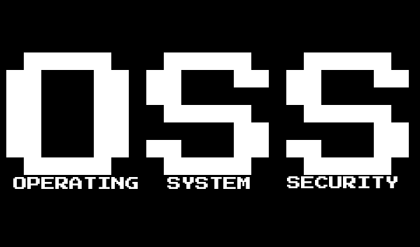
</picture>

<br>

**The missing GUI for security-related stuff on Linux that your distro forgot to ship.**

<br>

**Contributors welcome.** There's a lot of potential here and plenty of it is still open — see [Contributing](#contributing).

<br>


</div>

---

## Install

Grab the package for your distribution from [Releases](https://github.com/jegly/OSS/releases/latest), then:

| Distribution | Command |
|---|---|
| **Debian · Ubuntu · Mint · Pop!\_OS · elementary · Zorin** | `sudo apt install ./oss_1.1.0_all.deb` |
| **Arch · Manjaro · EndeavourOS · CachyOS** | `sudo pacman -U oss-1.1.0-1-any.pkg.tar.*` |
| **Fedora · Nobara · RHEL · Rocky · Alma** | `sudo dnf install oss-1.1.0-1.noarch.rpm oss-fonts-1.1.0-1.noarch.rpm` |
| **openSUSE Tumbleweed · Leap** | `sudo zypper install oss-1.1.0-1.noarch.rpm oss-fonts-1.1.0-1.noarch.rpm` |

The RPM ships the typefaces separately, so install both or the interface falls back to system fonts.

Or let it work out which one your system wants, build it, and install it:

```bash
./tools/install.sh
```

It reads `/etc/os-release` the same way the app does, prints the exact command before running it, and takes `--dry-run` if you want to see that first. It downloads nothing.

> [!IMPORTANT]
> Read [Distro support](#distro-support) before installing on Arch or Fedora. 672 of the 689 settings apply everywhere, but a handful of sections are still Debian-shaped and are skipped rather than applied there.

### Requirements

Everything is present on a stock desktop: `python3` (3.11+), `python3-gi`, GTK 4, libadwaita, polkit, fontconfig. The package is 4.6 MB and contains the app, the catalogue, the icon set and twelve typefaces.

There is **no AppImage, Flatpak or Snap**, and there will not be. See [Why no AppImage](#why-no-appimage-flatpak-or-snap).

---

## What is OSS?

OSS — Operating System Security — is a GTK4 app that puts Linux hardening settings in a window. You tick what you want, it shows you the exact diff of every file it is about to change, and applies the whole lot behind one password prompt.

---

## Why

There's no shortage of advice on hardening a Linux box. The Arch wiki, the CIS benchmarks, a hundred blog posts, and everybody's own half-remembered shell script all cover roughly the same ground. Knowing what to set was never really the hard part.

The hard part is that the settings live in about fifteen different places, in five different file formats, and there's nowhere you can look at all of them at once. So you edit `/etc/default/grub`, drop a file in `/etc/sysctl.d`, another in `/etc/modprobe.d`, rewrite half of `sshd_config`, tighten `fstab`, run some `ufw` commands you half remember, and then six months later you can't say what you set, what broke because of it, or whether a distro upgrade quietly put some of it back.

What makes that genuinely bad rather than just annoying is that most of these mistakes are **silent**:

- A misspelled sysctl key doesn't error, it's just ignored.
- A file in `/etc/sudoers.d` does nothing at all unless `/etc/sudoers` has the `@includedir` line, and nothing tells you it's being skipped.
- Settings in `/usr/lib/sysctl.d` get replaced on the next package upgrade.

You don't generally discover that your hardening did nothing — you just carry on believing it worked.

OSS makes the same edits you would. What it adds is that you see the diff before anything is written, everything it touches is backed up, a failure anywhere rolls the entire transaction back, and afterwards it re-reads every value off the live system to confirm the setting actually took.

### Distro-hopping without losing your posture

Changing distro costs you your security posture. Someone who has spent years working out what to set on Ubuntu moves to Arch and is more or less starting again — different paths, different tooling, different defaults, and the same settings living somewhere else entirely. The concepts carry over perfectly well; none of the specifics do. So people either spend a fortnight relearning it or, more often, just don't bother, and run a less secure machine than the one they left.

OSS is meant to carry that across. Same settings, described the same way, with the app working out where they actually live on the machine you're on now. **Capture** reads your current configuration into a preset, and applying that preset on the new install should put you back roughly where you were.

### The threat model moved

Local hardening used to be easy to skip on a desktop: if something is already running as your user, the reasoning went, you have lost anyway. That was never quite true, but it was close enough while the only things running as you were things you had personally installed and understood.

It isn't close enough now. A normal desktop runs coding agents, editor extensions, language servers, MCP servers and package post-install scripts — all with your full user permissions, most pulling code you have not read, some of it chosen at runtime by a model. None of that needs to be malicious to be a problem. The interesting question stopped being *"is this process trusted"* and became *"how much can it reach if it turns out not to be"*.

Nothing here is new, which is rather the point — the kernel has had most of it for a decade:

| Setting | What it stops |
|---|---|
| `kernel.yama.ptrace_scope` | One process reading another's memory — how a browser token or SSH agent key gets lifted |
| `fs.protected_symlinks` · `fs.protected_regular` | Symlink races that turn a world-writable temp directory into arbitrary file overwrite |
| `kernel.unprivileged_userns_clone` | The usual route from unprivileged code to kernel attack surface |
| Per-unit systemd sandboxing | What a compromised service can see of the rest of the filesystem |
| USB device policy · snap permissions | Physical and packaged-app reach |

What's missing was never the mechanism. It's that almost nobody turns them on, because until now you had to know they existed, know what each one breaks, and find them across fifteen files.

### How it compares

| | Preview | Undo | Verifies it took | Scope |
|---|---|---|---|---|
| **OSS** | Full file diff | Transaction rollback | Reads back live state | 689 settings, 27 areas |
| Lynis and other auditors | — | — | — | Reports only, you fix it |
| SCAP / OpenSCAP | Profile-level | — | Scan re-run | Compliance reporting |
| Hardening scripts | — | — | — | Applies blind |

---

## Screenshots

| | |
|:---:|:---:|
| 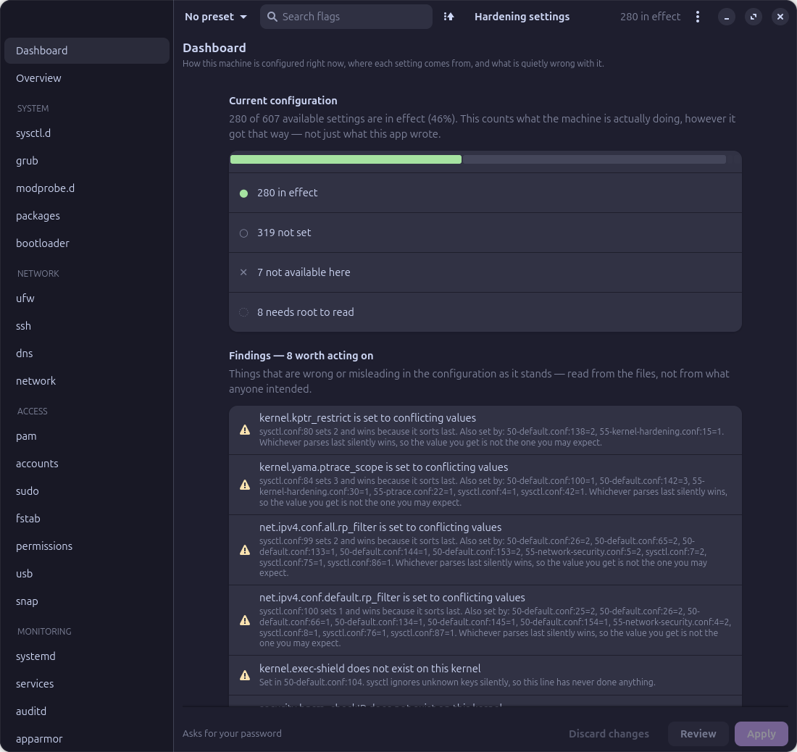 |  |
| **Dashboard** — what the machine is actually doing, and what's quietly wrong with it | **sysctl.d** — 169 kernel, memory and network settings |
|  | 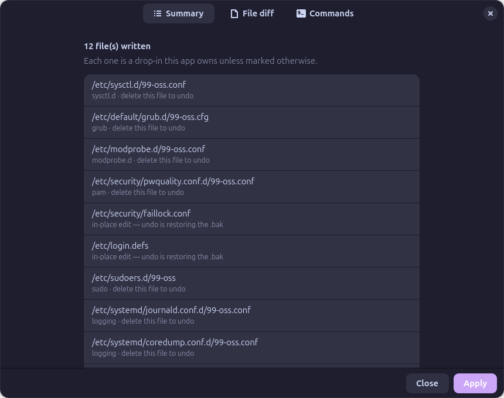 |
| **GRUB** — kernel command line, every flag risk-rated | **Review** — every file and command, before anything is written |
| 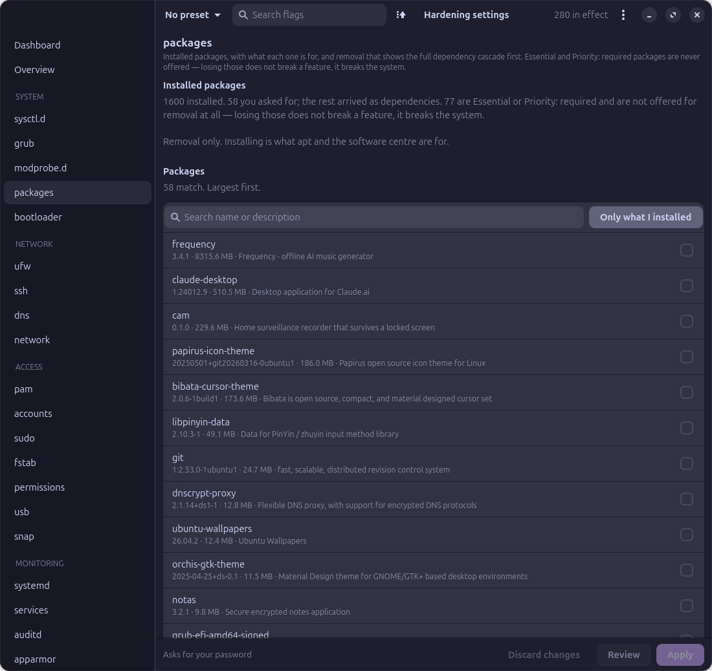 | 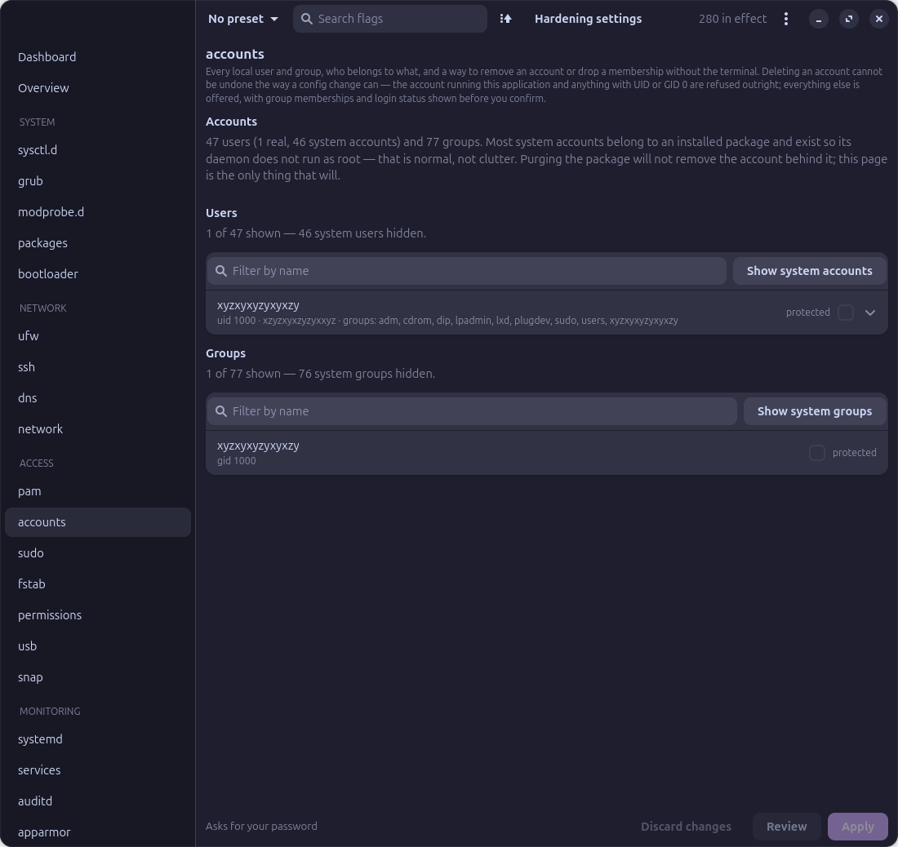 |
| **Packages** — removal with the real dependency cascade | **Accounts** — users, groups and the system accounts nothing else cleans up |
| 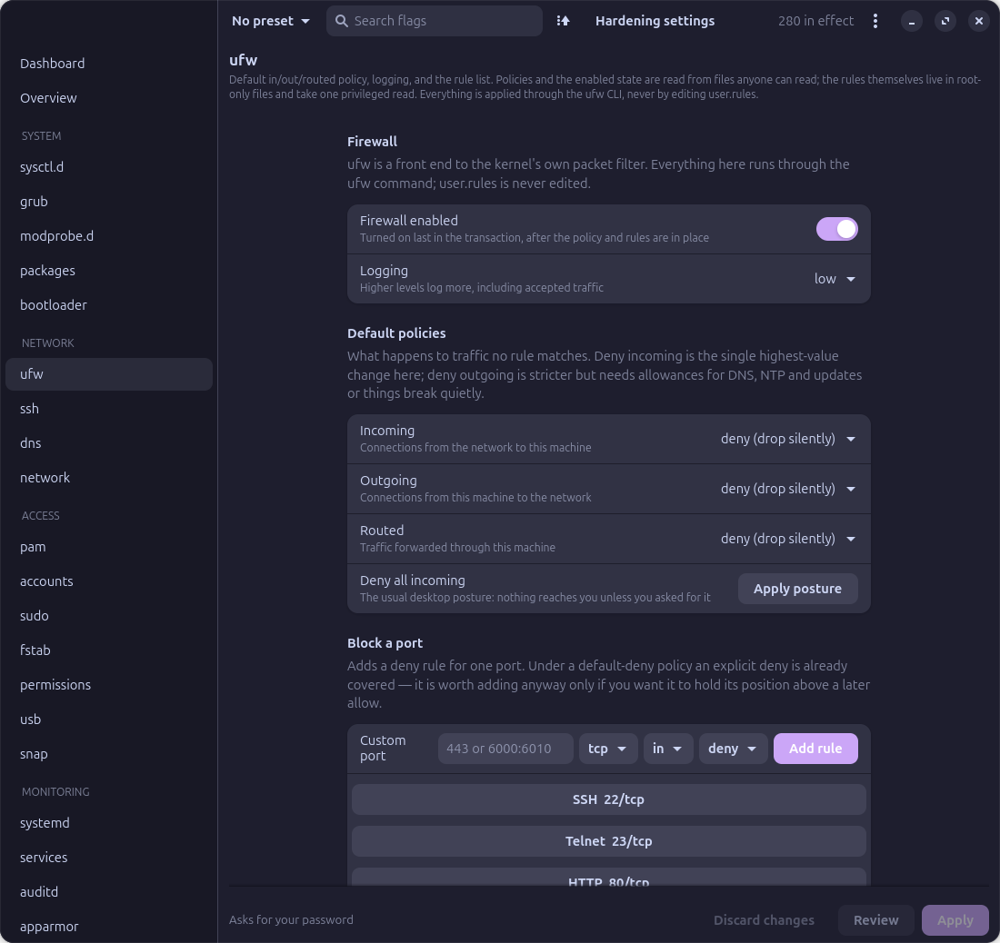 | 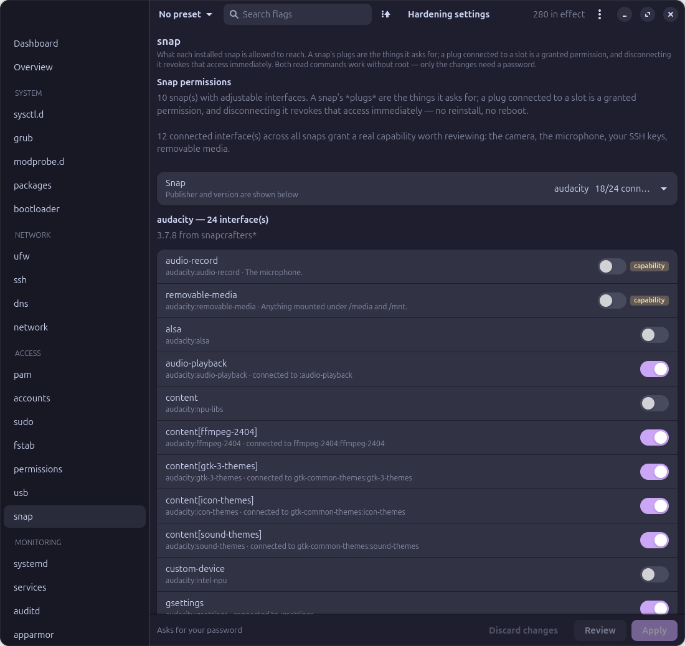 |
| **Firewall** — ufw policies and rules | **Snap** — the permission UI snapd doesn't have |
| 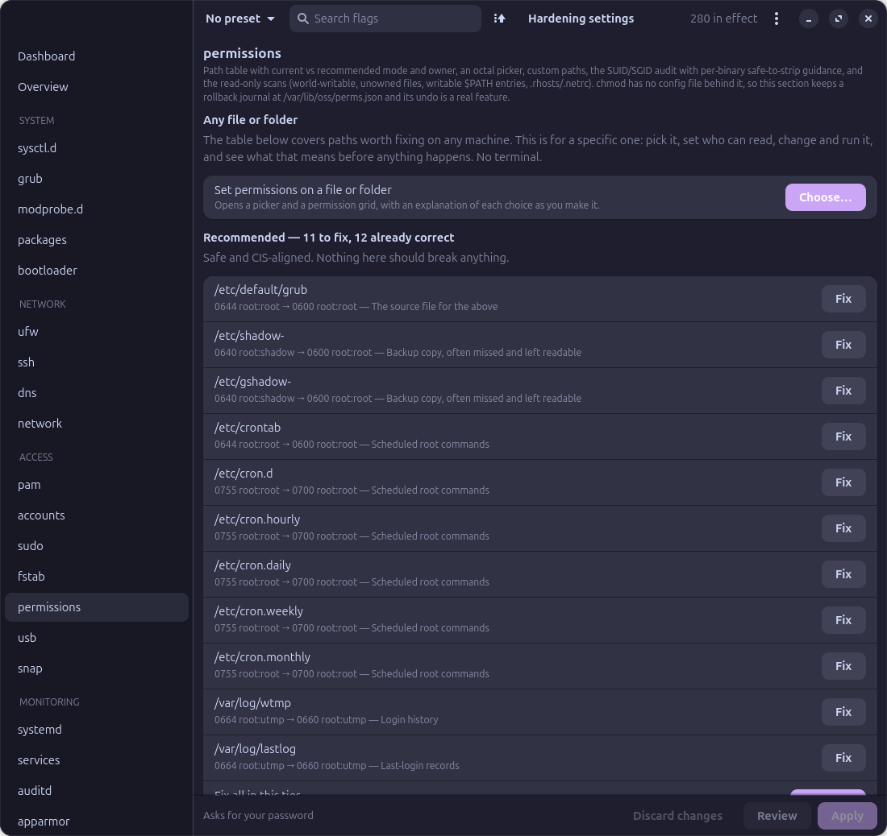 | 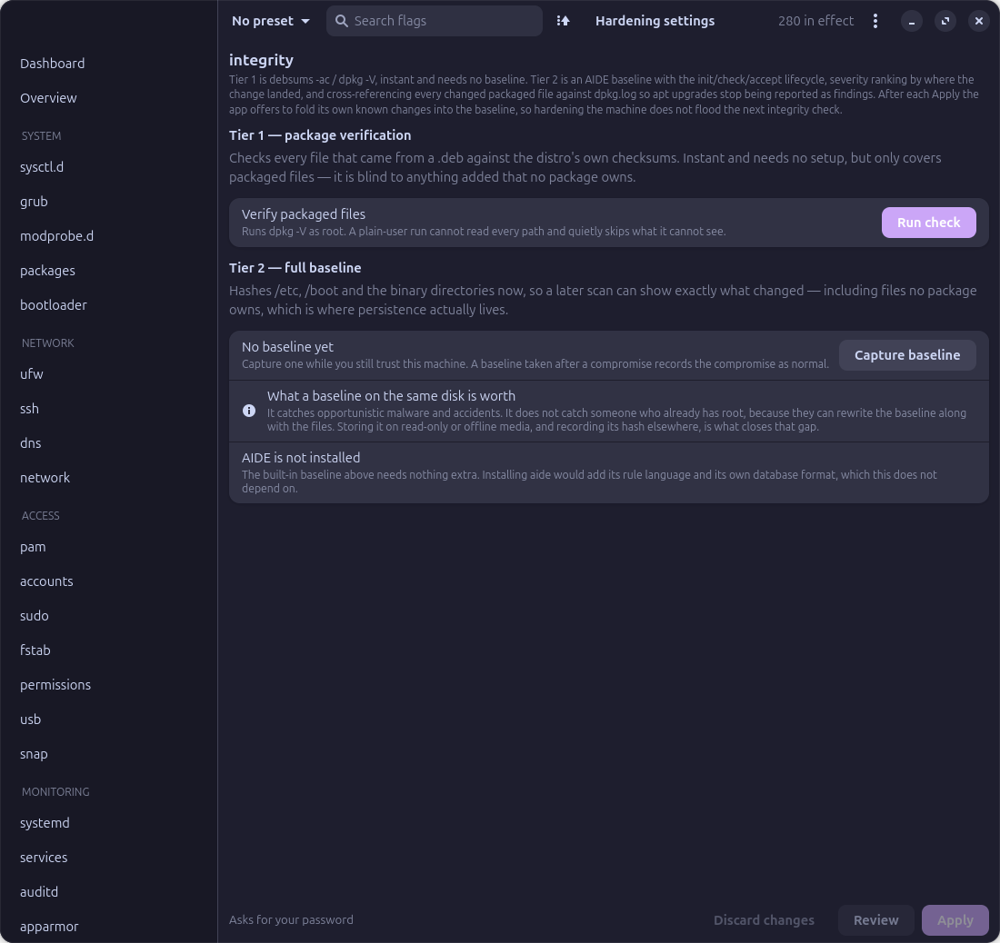 |
| **Permissions** — SUID/SGID review and file modes | **Integrity** — package verification and a full baseline |
|  | 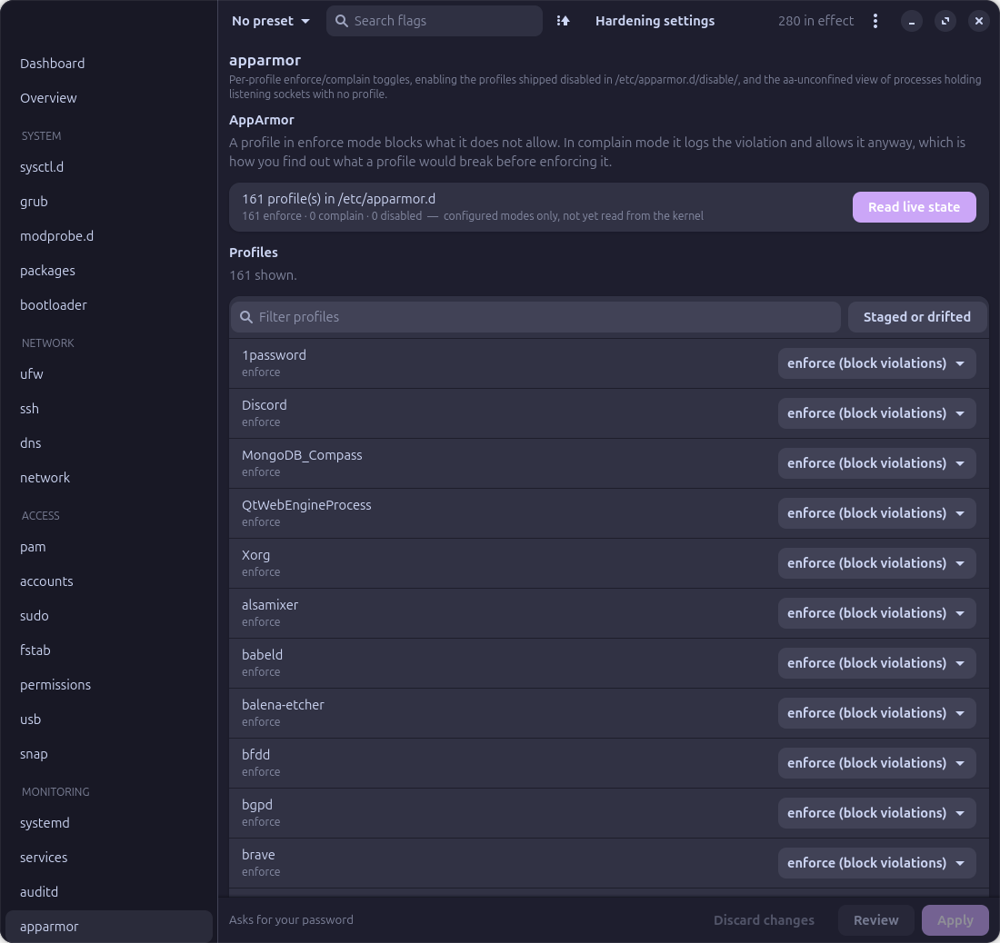 |
| **Services** — what's running that needn't be | **AppArmor** — profile modes and unconfined processes |
|  |  |
| **modprobe.d** — 170 kernel modules you can refuse to load | **PAM** — password quality, lockout and login policy |
|  | 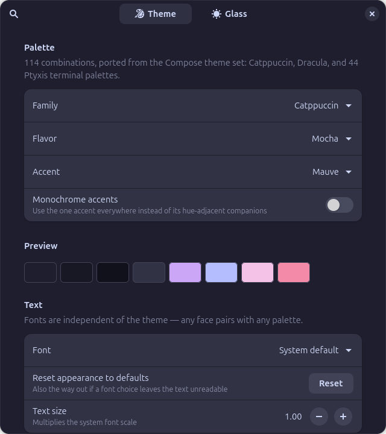 |
| **auditd** — what gets recorded, and where it goes | **Appearance** — 114 palettes, contrast-corrected |

---

## What's in it

**26 sections, 689 settings.** All of it lives in TOML data files under `data/catalogue/`, so adding a setting means editing data, not code.

| Group | Sections |
|---|---|
| **System** | sysctl (kernel, memory, network), GRUB command line, module blacklists, kernel debloat, installed packages, TPM and measured boot, bootloader password |
| **Network** | ufw policies and rules, SSH, DNS over TLS, NetworkManager MAC privacy |
| **Access** | PAM and passwords, users and groups, sudo, mount options, file permissions, USB device policy, snap permissions |
| **Monitoring** | systemd sandboxing, services, auditd, AppArmor, journald, file integrity |
| **Desktop** | telemetry, automatic updates, screen lock, login screen |

### Worth calling out

**Dashboard** — reports how the machine is configured right now, regardless of whether this app had anything to do with it. On the machine I built this on, it turned up five sysctl keys set to conflicting values in different files, 20 settings sitting in `/usr/lib/sysctl.d` where a package upgrade would overwrite them, a `crashkernel=` reservation that `kexec_load_disabled=1` had quietly made useless, and a default-deny outbound firewall with no rule for NTP, which explained why the clock kept drifting.

**Kernel debloat** — a stock Ubuntu kernel ships around 6,900 loadable modules and boots using about 130. Every one of the rest is code the kernel will autoload on demand: a device appearing, an image being mounted, a packet arriving for a protocol nobody uses. This browses all of them, classified against what the running system actually depends on — loaded modules and mounted filesystems are refused outright, storage, input, HID and graphics are flagged risky because "not loaded now" doesn't mean "not needed at next boot", and the remainder are candidates. On the machine I built this on that's 126 refused, 1,258 risky, 5,517 candidates. Blacklisting only: deleting the `.ko` files buys nothing that `install <mod> /bin/false` doesn't, and costs you dpkg integrity, every kernel update putting them back, and any way to undo it without rescue media. The section says so rather than hiding it.

**CPU vulnerabilities** — the dashboard reads `/sys/devices/system/cpu/vulnerabilities` and reports what's mitigated, what this CPU isn't affected by, and what's still vulnerable. This is the one part of the app the catalogue can't change: the kernel decides what it can mitigate, and some bugs have no fix available at all. It's worth showing precisely because a machine can be fully hardened by this app and still be vulnerable here.

**TPM** — whether there's a TPM, what the firmware measured into it, and whether the disk key is actually sealed to it. A TPM with nothing bound to it protects nothing, and one that unseals with no PIN means powering the machine on is enough to decrypt it. Read-only by design: sealing a disk key wrong locks you out of your own disk, so the page prints the exact `systemd-cryptenroll` command instead of offering a checkbox.

**Packages** — lists everything installed with the package manager's own description, defaulting to packages you asked for rather than ones that arrived as dependencies. Removals go through a simulated run first, so ticking `ubuntu-wallpapers` reports that it would also take `gdm3` and `gnome-shell`, and `libgtk-3-0t64` comes to 64 packages and 670 MB. There's no install path, deliberately.

**Users and groups** — removing a package doesn't remove the system account it created. Debian avoids doing that on purpose, since the UID might still own files somewhere on disk, so these accounts accumulate and nothing ever cleans them up. The account you're running as, and anything with UID 0, are refused — in the GUI, and again independently in the privileged helper.

**Snap permissions** — snaps have no permission UI at all outside `snap connections` and `snap disconnect`. Interfaces are sorted by whether they need a decision from you: camera, microphone, `removable-media` and `ssh-keys` first, then the mundane ones, then the ones that will break the snap if you revoke them.

**Capture** — reads the effective configuration rather than copying config files around, maps what it finds onto the catalogue, and tells you what it saw. A machine hardened by hand accumulates keys that stopped doing anything years ago; this one had `kernel.exec-shield` and `security.bprm_checkIP` sitting in its config, neither of which has existed in a kernel for a very long time.

**Back up and restore** — the other half of that, and deliberately not the same thing. Capture reads the effective state and maps it onto the catalogue; this copies the **files themselves**, from 21 locations derived from the catalogue, including every hand-made setting this app knows nothing about. Your config becomes one `.tar.gz` you can read yourself.

Both directions are per-category, because a configuration isn't always portable in one piece. Restoring onto a machine with different usernames? Leave `/etc/sudoers.d` out. Different disks? Leave `/etc/fstab` out. Restoring shows which files would be created and which replaced before anything is written, then goes through the same transaction as an ordinary apply — `.bak` first, validators where they exist, everything put back if any step fails.

---

## Not breaking your machine

| Mechanism | How it works |
|---|---|
| **Undo is deleting a file** | Most sections write a single drop-in. Remove it, re-run the reload, that section is back to stock. |
| **In-place edits are backed up** | `/etc/default/grub`, `login.defs`, `faillock.conf`, `fstab` and file permissions have no drop-in mechanism, so they get a `.bak`, keep their existing mode, and only their managed keys are touched. Comments, ordering and anything you set by hand survive. |
| **The helper doesn't trust the GUI** | `/usr/libexec/oss-helper` takes one JSON file and re-renders every target from the shipped catalogue itself. It accepts only flag ids and values, each checked against the catalogue's own allowlist. |
| **Nothing reaches a shell** | Every command is on a fixed list. Free-form input is pattern-checked at both ends — ports, unit names, snap plugs, package names, account names. |
| **Validators run first** | `sshd -t`, `visudo -c`, `auditctl -R` against the candidate file. For `fstab`, a live `mount -o remount`, so an option the kernel won't accept fails while the filesystem is still mounted rather than at boot. |
| **One transaction** | Any failure restores every file and inverts the unit changes. |
| **Read-back after apply** | Every value is re-read off the live system and reported as in effect, waiting for a reboot, or didn't take. |
| **A parameter being set is not proof it worked** | For CPU mitigations the kernel has the last word and publishes it in sysfs, so that is what gets believed — not the presence of the token on the command line. `spec_store_bypass_disable=on` alongside `nospec_store_bypass_disable` reads as drift, naming the parameter that overrode it, rather than as applied. |
| **A way out that isn't this app** | Back up every configuration location to a plain `.tar.gz` before you change anything. Restoring goes through the same transaction, per category, and the archive stays readable with `tar` if you'd rather not. |
| **Irreversible things are gated** | `kexec_load_disabled`, `modules_disabled`, `lockdown=confidentiality` and audit `-e 2` appear in no preset except `paranoid`, and Apply stays disabled until you've scrolled to the end of the risk summary. |
| **The platform is checked, not assumed** | Ubuntu 26.04 ships `sudo-rs`, which rejects four sudoers directives GNU sudo has. Those are greyed out with the reason rather than failing the transaction at validation time. |

---

## Distro support

The packaging is portable. The catalogue is not yet.

The app works its family out from `/etc/os-release` at startup — not per-distro forks, and not a picker, because the machine already knows the answer and a wrong answer would write config to paths that silently do nothing. Set `OSS_DISTRO_FAMILY` to override.

**672 of the 689** settings are distro-neutral: `/etc/default/grub`, `/etc/sysctl.d`, `/etc/modprobe.d`, `/etc/sudoers.d`, `/etc/audit/rules.d` and the journald, resolved and NetworkManager drop-in directories work the same way everywhere. Two reload commands and three unit names are resolved per family:

| Debian | Arch | Fedora · openSUSE |
|---|---|---|
| `update-grub` | `grub-mkconfig -o /boot/grub/grub.cfg` | `grub2-mkconfig -o /boot/grub2/grub.cfg` |
| `update-initramfs -u` | `mkinitcpio -P` | `dracut --force --regenerate-all` |
| `ssh.service` | `sshd.service` | `sshd.service` |
| `smbd` · `nmbd` · `rsync` | `smb` · `nmb` · `rsyncd` | `smb` · `nmb` · `rsyncd` |

The grub section **used to be** on this list, because it wrote `/etc/default/grub.d/99-oss.cfg` — a Debian invention that Fedora and Arch's `grub-mkconfig` never reads. It now merges into `/etc/default/grub` itself, which every family reads, so the restriction is gone and its 61 settings work everywhere.

That was worth doing for its own sake, drop-in or not. Splitting the truth across two files meant the `GRUB_CMDLINE_LINUX_DEFAULT` you read in `/etc/default/grub` was not the line that booted, and anything you set there by hand was silently overridden by a drop-in sourced after it. An upgrade removes a stale `99-oss.cfg` on the next apply, because grub sources it *after* the real file and it would otherwise quietly outrank everything merged in.

These still do **not** translate:

| Section | Problem elsewhere |
|---|---|
| updates (17 settings) | writes `/etc/apt/apt.conf.d`; Fedora uses `dnf-automatic`, Arch has no equivalent |
| pam (39 settings) | edits `login.defs` in place, but on Fedora the PAM stack belongs to `authselect`, which overwrites it |
| ufw · apparmor · packages · integrity | need firewalld, SELinux, and dnf/rpm or pacman backends |

`updates` is the only section whose target file has no equivalent at all, so it declares `families = ["debian"]` and is skipped entirely elsewhere — in the GUI and independently in the helper. Substituting only a reload command would be worse than leaving it alone: the command would run happily while the file it was meant to activate sat where nothing reads it.

**The Arch and RPM packages are still behind the Debian one**, but much less so than before: 672 of the 689 settings apply everywhere, and the sections that don't are skipped honestly rather than written and ignored.

### Why no AppImage, Flatpak or Snap

polkit matches an action to **one literal absolute path**. A helper running from a randomised mountpoint can never be authorised, and neither Flatpak nor Snap can install a polkit action into a directory polkit reads. Every workaround ends up being a privileged first-run bootstrap that drops root-owned files outside the package manager — which is exactly the sort of thing this app's integrity section exists to catch.

A hardening tool has to be installable through the mechanism it tells you to trust.

---

## Building from source

```bash
git clone https://github.com/jegly/OSS
cd oss

./tools/build-deb.sh          # Debian, Ubuntu and derivatives
./tools/build-arch.sh         # Arch — needs base-devel
./tools/build-rpm.sh          # Fedora, RHEL, openSUSE

./tools/packaging-gate.sh     # everything checkable without a VM
```

The Arch and RPM wrappers build a source tarball from your working tree, including uncommitted changes, because that's usually the thing you're testing.

### Development

```bash
PYTHONPATH=src python3 oss              # run from the tree
python3 -m unittest discover -s tests   # 285 tests
python3 tools/audit-targets.py          # check every target against this system
python3 tools/screenshot.py out.png --section ufw
python3 tools/build_presets.py          # regenerate the derived presets
```

Modules directly under `src/ossgui/` are stdlib-only, so the privileged helper can import them. Anything that touches `gi` lives in `src/ossgui/ui/`. GTK tests skip themselves when there's no display, since the package build runs the suite in a chroot.

`tools/audit-targets.py` is worth running after changing any target path. It checks that nothing we write is owned by a package unless declared in-place, that our filename isn't already taken, that our file sorts last so our values win, that the consuming tool actually reads that directory, and that the rendered output passes that tool's own validator.

Applying from a source checkout doesn't work and isn't meant to. The helper ships in the package at `/usr/libexec/oss-helper`, so Apply refuses outright rather than half-working.

---

## Appearance

**114 palettes**, ported from a Compose theme set: Catppuccin at 4 flavours × 14 accents, Dracula light and dark × 7 accents, and 44 Ptyxis terminal palettes carrying their full 16-slot ANSI tables. Plus a glass mode with translucent surfaces and a hairline edge.

Terminal palettes were designed for terminal text, and a fair few fall well under WCAG AA once they're driving UI chrome instead — C64 reads at 1.5:1. Rather than drop those palettes, colours get walked away from the background until they clear the threshold.

---

## Contributing

Contributions are very welcome. This is a large idea with a lot of surface still open, and most of what's missing doesn't need deep knowledge of the codebase — it needs someone who knows a distro, or a subsystem, better than I do.

**The biggest gap is distro support.** 672 of the 689 settings already work everywhere; the rest are Debian-shaped, and each one is a self-contained piece of work:

| Where help is most useful | What it involves |
|---|---|
| **A firewalld backend** | The ufw section needs an equivalent for Fedora and openSUSE. |
| **SELinux alongside AppArmor** | The AppArmor page has no counterpart on Fedora or RHEL. |
| **dnf and pacman backends** | For the packages and integrity sections, which are apt- and dpkg-shaped today. |
| **PAM under `authselect`** | Editing `login.defs` in place is wrong on Fedora, where authselect owns the stack. |
| **`dnf-automatic`** | The updates section writes `/etc/apt/apt.conf.d`; Arch has no equivalent at all. |

**Testing on real hardware is genuinely valuable.** The Arch and RPM packages are built on Debian and their dependency lists have never been verified against a real Arch or Fedora. If you run either, installing the package and reporting what breaks is one of the most useful things you can do.

**Adding settings needs no Python.** The whole catalogue is TOML in `data/catalogue/` — 25 files. A new setting is a handful of lines describing what it does, what it breaks, and how risky it is. Run `python3 tools/audit-targets.py` afterwards: it checks that the file we'd write is actually read by the tool that's supposed to read it, that it sorts last so our values win, and that the output passes that tool's own validator.

**Also open:** the `recommended` preset is currently generated — every flag rated `safe`, which is 427 settings. That's not a recommendation, it's "everything we were fairly sure wouldn't break". A curated, genuinely small `recommended` would be a real improvement.

### Before you open a PR

```bash
python3 -m unittest discover -s tests   # 285 tests, must stay green
python3 tools/audit-targets.py          # if you touched any target path
./tools/packaging-gate.sh               # if you touched packaging
```

There's no CI yet, so please run the suite locally. Two conventions worth knowing: modules directly under `src/ossgui/` are stdlib-only so the privileged helper can import them, and comments here explain **why** rather than what — usually naming the specific failure that motivated the code, because most of this codebase exists to stop something silent from happening again.

Anything touching the privileged helper or the transaction gets read closely, and a change there wants a test that fails without it. Bug reports are contributions too — especially with the Apply-failed detail, which is copyable.

---

## Licence

<div align="center">


</div>

Licensed under the Apache License, Version 2.0 — see [LICENSE](LICENSE).
Copyright 2026 Jegly

The bundled typefaces are under the SIL Open Font License 1.1; Cormorant Garamond is copyright 2015 The Cormorant Project Authors. Full breakdown in [`debian/copyright`](debian/copyright).

---

## Links

| | |
|---|---|
| Repository | https://github.com/jegly/OSS |
| Releases | https://github.com/jegly/OSS/releases |
| Issues | https://github.com/jegly/OSS/issues |
| Manual page | `man oss` |
| Cormorant Garamond | https://github.com/CatharsisFonts/Cormorant |
| Catppuccin | https://github.com/catppuccin |
| Dracula | https://draculatheme.com |
