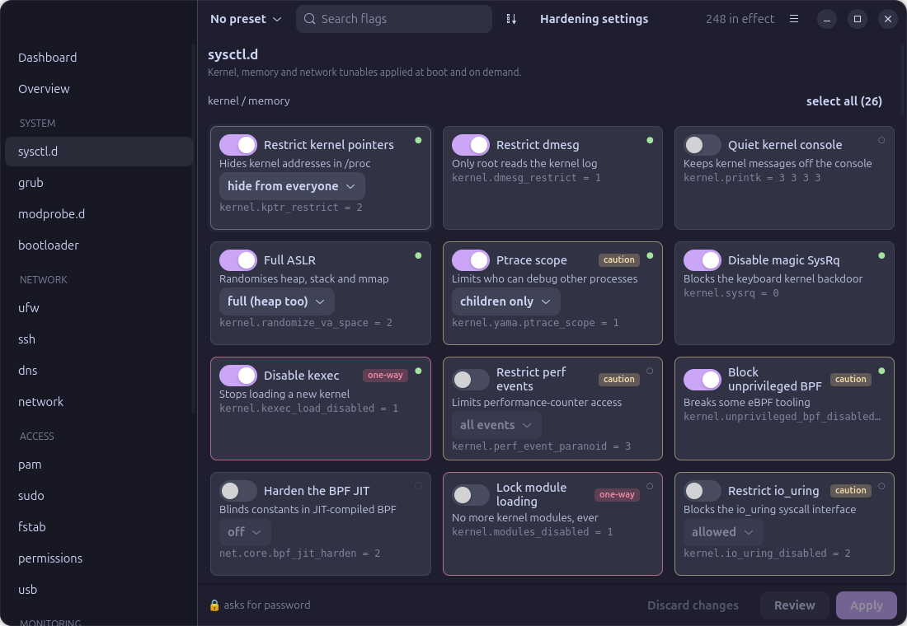
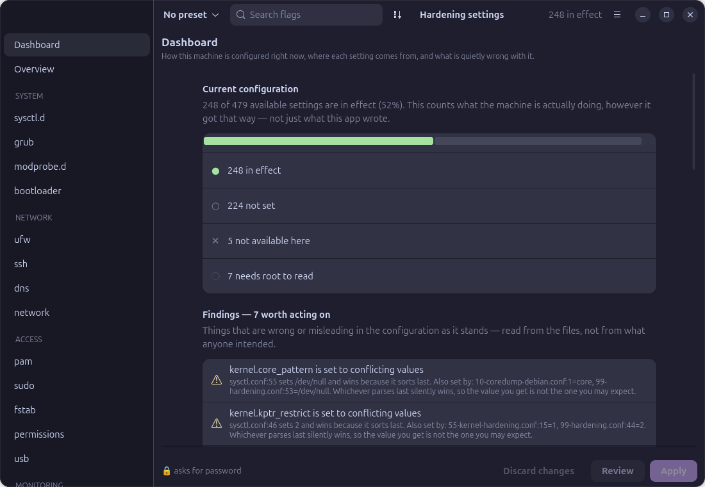

# Hardening Control Center

A GTK4 control centre for Linux hardening. Pick settings from categorised grids,
review the literal diff of every file that will change, then apply the whole set
through one password prompt.

Built for Ubuntu 26.04. Installs with `dpkg -i` on a machine that has never been
online — everything it needs ships with a stock desktop.





## Why it exists

Hardening a machine usually means hand-editing `/etc/default/grub`,
`/etc/modprobe.d/*`, `/etc/sysctl.d/*`, `sshd_config` and `fstab`, then running
`ufw` commands from memory, on every new install. Six months later nobody can
say what is set, what it broke, or whether an upgrade quietly undid half of it.

This does the same edits, but shows you the diff first, backs up what it
touches, rolls back as a unit when something fails, and reads every value back
afterwards — because an invalid sysctl key fails **silently**, and a tool that
reports success for a line that has never done anything is worse than no tool.

## What it covers

| | |
|---|---|
| **System** | sysctl (kernel, memory, network), GRUB command line, module blacklists, bootloader password |
| **Network** | ufw policies and rules, SSH, DNS over TLS, NetworkManager MAC privacy |
| **Access** | PAM and password policy, sudo, mount options, file permissions, USB device policy |
| **Monitoring** | systemd sandboxing, services, auditd, AppArmor, journald, file integrity |
| **Desktop** | telemetry, automatic updates, screen lock and login screen |

484 flags across 22 sections, defined in TOML data files rather than code —
adding one is editing data.

## How it stays out of trouble

**Undo is deleting a file.** Every section writes one drop-in. Delete it, re-run
the reload, and that section is stock again. The two things with no drop-in
mechanism — `fstab` and file permissions — keep their own records instead: a
`.bak` and a rollback journal.

**The helper doesn't trust the GUI.** `/usr/libexec/hardening-gui-helper` takes
one JSON file and re-renders every target from the shipped catalogue itself. All
it accepts is flag ids and values, each checked against the catalogue's own
allowlist. Nothing is interpolated into a shell, and every command it can run is
on a fixed list.

**Validators run before writes.** `sshd -t` on the candidate config, `visudo -c`
on the candidate sudoers, `auditctl -R` on the candidate rules, and a live
`mount -o remount` before `fstab` is touched — so an entry the kernel would
reject fails while the filesystem is still mounted, rather than at boot.

**Read-back after apply.** Every value is re-read and classified: in effect,
waiting for a reboot, or didn't take.

**Irreversible changes are gated.** One-way flags — `kexec_load_disabled`,
`modules_disabled`, `lockdown=confidentiality`, audit `-e 2` — are never included
by a preset except `paranoid`, and Apply stays disabled until you have scrolled
to the end of the risk summary.

## Dashboard

The landing screen reports how the machine is configured **now**, not what this
app has done to it: counts by state, where each setting is winning from, and
findings. On the machine it was developed against it found five sysctl keys set
to conflicting values across different files, twenty settings living in
`/usr/lib/sysctl.d` where the next package upgrade would overwrite them, a
`crashkernel=` reservation made useless by `kexec_load_disabled=1`, and a
default-deny outbound firewall with no allowance for NTP — so the clock had been
quietly drifting.

## Install

```
sudo dpkg -i hardening-gui_0.1.0_all.deb
```

Build it yourself:

```
./tools/build-deb.sh
./tools/packaging-gate.sh
```

The bundled typefaces are a separate package, because 17MB of TTFs would be most
of the main package's size for something optional:

```
sudo dpkg -i hardening-gui-fonts_0.1.0_all.deb
```

Without it the app uses the system font and the picker simply does not list the
faces that are missing.

Optional tools unlock extra sections and are never hard dependencies:
`auditd`, `usbguard`, `debsums`, `apparmor-utils`, `openssh-server`. Each section
detects absence and says which package it needs.

## Capture

**Capture this system** reads the effective configuration — the merged sysctl
chain and the live kernel values, not the files — maps it onto the catalogue, and
reports what it found before saving anything. On the reference machine that is
242 settings and nine findings worth acting on.

Reading the effective state rather than copying files is the point: a
hand-hardened machine accumulates keys that have never done anything.
`kernel.exec-shield` and `security.bprm_checkIP` were both sitting in the
reference machine's config, and neither has existed in a kernel for years.
Copying the files forward carries the mistakes; capturing and validating does
not. Settings in effect that the app does not manage are recorded as custom
entries rather than silently dropped.

## Appearance

114 theme combinations ported from a Compose theme set: Catppuccin (4 flavours ×
14 accents), Dracula (light and dark × 7 accents), and 44 Ptyxis terminal
palettes carrying their full 16-slot ANSI tables. Plus a glass mode with
translucent surfaces and a luminous hairline.

Terminal palettes were authored for terminal text, so several are well under
WCAG AA once they are driving UI chrome — C64 reads at 1.5:1. Colours are walked
away from the background until they clear the threshold, so every palette stays
readable rather than being dropped.

## Development

```
PYTHONPATH=src python3 hardening-gui        # run from the tree
python3 -m unittest discover -s tests       # 52 tests
python3 tools/screenshot.py out.png --section ufw
python3 tools/build_presets.py              # regenerate derived presets
```

The modules directly under `src/hardeninggui/` are stdlib-only so the privileged
helper can share them; everything importing `gi` lives in `src/hardeninggui/ui/`.

Destructive paths — `fstab`, SUID stripping, USBGuard, faillock,
`kernel.modules_disabled` — should be tested in a VM snapshot, not on a machine
you need. Each can lock you out in a different way.

## Licence

GPL-3.0.
